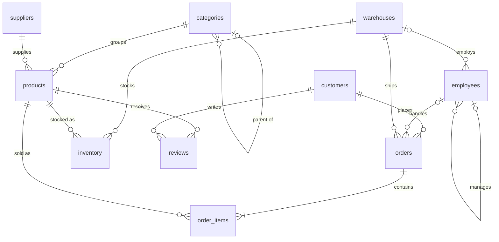
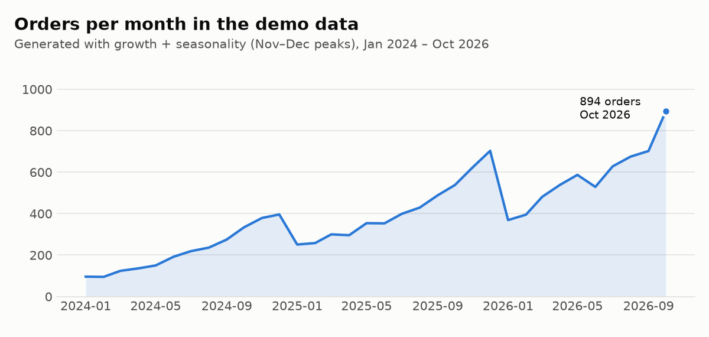
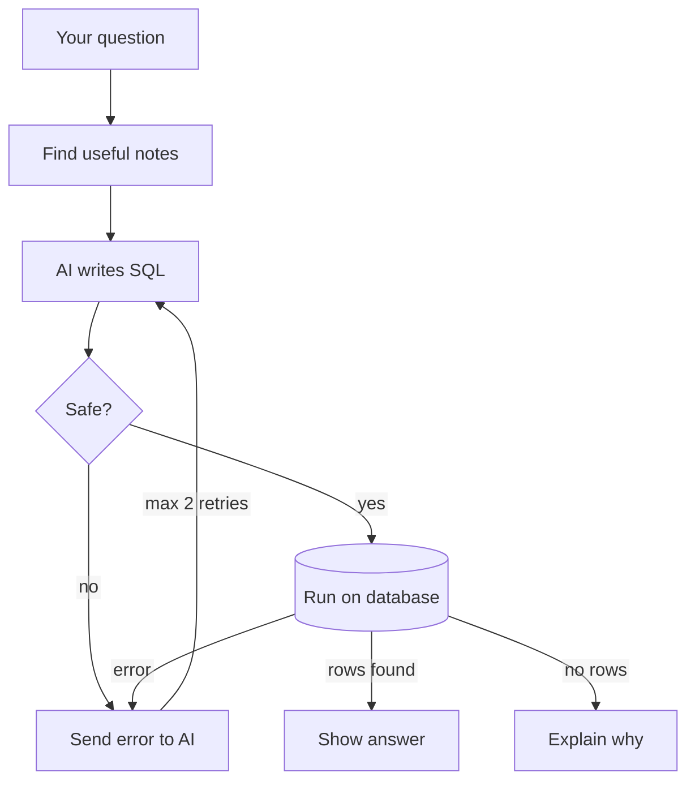

# TableTalk 🗄️💬

**Ask a database questions in plain English.** TableTalk writes the SQL, checks that it is safe, runs it, and shows the answer as a **table** and a **chart**, along with the exact query it used.


> **Example:** *"Which 3 sub-categories made the most profit in FY2026?"*
>
> **Answer:** `Laptops $303k · Cycling $230k · Furniture $116k`

---

## 💡 What problem does it solve?

A shop keeps its information (customers, products, orders) in a **database**. Think of it as a set of very big Excel sheets.

To ask the database a question, you must write in a language called **SQL**. Many people don't know SQL.

**TableTalk lets you ask in normal English.** It works like a **translator** between a person and a database.

## ✨ What you can do

| Feature | What it means |
|---|---|
| **Answers in easy words** | Each result comes with a short plain-English explanation |
| **Upload your own data** | Add CSV or Excel files and ask questions about them |
| **Ask back** | If your question is unclear, it can ask what you meant instead of guessing |
| **Thumbs up / down** | A liked answer is reused as an example for similar questions |
| **Write your own rules** | Tell it what words like *revenue* mean for your data |
| **Demo store** | A ready-made example to try without uploading anything |

### Uploading data

1. Open **Your data** and choose your files.
2. Check the columns. Ones that look private (email, phone, address) are suggested to be **left out**.
3. Give it a name, add rules if you like, and click **Create dataset**.
4. Pick it under **Dataset** in the sidebar and ask.

> **Privacy:** your questions, table and column names, some column values and your rules are sent to Google's Gemini. With **Explain results** on (the default), up to 30 rows of each result are sent too. Do not upload confidential data.

## 🧩 The main parts

| Part | What it is | In easy words |
|---|---|---|
| **PostgreSQL** | The database | The cupboard where all the data is kept |
| **Python** | The programming language | The worker who connects everything |
| **Gemini** | Google's AI model | The brain that writes the SQL |
| **Streamlit** | A tool for making web pages in Python | The screen you see and type on |
| **RAG** | Giving the AI helpful notes before it answers | An open-book exam |

## 🗃️ The demo data

It is a **made-up online store**, so no real people are in it. It has **10 tables**:

| Table | What it stores | Rows |
|---|---|---:|
| **customers** | Who buys | 2,000 |
| **categories** | Types of products | 24 |
| **suppliers** | Who gives products to the store | 25 |
| **products** | What is sold | 300 |
| **warehouses** | Where stock is kept | 6 |
| **inventory** | How much stock is in each warehouse | 1,260 |
| **employees** | Staff | 60 |
| **orders** | Each purchase | 14,211 |
| **order_items** | The products inside each purchase | 27,656 |
| **reviews** | Star ratings | 6,759 |

The tables are connected. For example, each order stores a `customer_id`, which tells you who placed it. This link is called a **foreign key**.

<details>
<summary><b>See how the tables connect</b></summary>



</details>

<picture>
  <source media="(prefers-color-scheme: dark)" srcset="docs/images/monthly_orders_dark.png">
  
</picture>

## 🤔 Why not just ask the AI directly?

The AI knows SQL, but it **doesn't know this company's rules**.

| The AI might guess… | …but this company means |
|---|---|
| Revenue = adding up all prices | Quantity × price after discount, **not counting cancelled and returned orders** |
| FY2026 = January to December 2026 | **1 April 2025 to 31 March 2026** |
| `status = 'Canceled'` | The real value is `'cancelled'` |
| "Top rated" = highest single review | Average rating, with **at least 10 reviews** |

A new employee would also get these wrong if nobody told them. So we give the AI notes. That is **RAG** (Retrieval-Augmented Generation).

There are **49 notes**:

- **10** describing the tables
- **18** business rules
- **21** solved example questions

## ⚙️ What happens when you ask a question



1. **Find the useful notes.** Your question is turned into a list of numbers that stands for its *meaning* (called an **embedding**). The notes with the closest meaning are picked.
2. **Build the message for the AI.** It contains the table details, the picked rules, similar examples, your recent questions and your new one. So you can ask a follow-up like *"now only for India"*.
3. **The AI writes SQL.**
4. **A security guard checks it.** Only reading is allowed.
5. **The database runs it.**
6. **If there is an error, the AI tries to fix it.** It gets 2 more chances.
7. **If nothing is found, it explains why** instead of showing a blank screen.
8. **You see the answer:** a short explanation in easy words, the SQL, a table, a chart and a download button.

### Example of an empty result

| You ask | TableTalk says |
|---|---|
| *List the customers who live in Japan* | **No matching data.** No customers live in Japan, and it tells you which countries do exist. |

## 🔒 Safety: 3 locks

What if the AI writes *"delete all customers"*?

| Lock | How it protects the data |
|---|---|
| **1. Code check** | The query is rejected unless it is a single read-only `SELECT` on the chosen dataset's tables |
| **2. Limited user** | The database user that runs the query only has permission to **read** |
| **3. Timer** | Any query running longer than **8 seconds** is stopped |

## 🧠 A bit of DSA inside

Sometimes two tables are not directly connected, so you must go through other tables, like changing trains.

**BFS (Breadth-First Search)** finds the route with the fewest stops. It is used in the mode that sends the AI only the relevant tables. The default mode sends all 10 tables.

## 📊 How do we know it works?

There is an exam of **25 questions**, each with a correct query written by hand. A question passes if the AI's query returns the **same data**.

| What the AI is given | Score | Easy | Medium | Hard |
|---|---:|---:|---:|---:|
| Only the table details | **64%** | 4/4 | 7/12 | 5/9 |
| All tables + rules and examples (RAG) | **96%** | 4/4 | 12/12 | 8/9 |
| Relevant tables + rules and examples (RAG) | **96%** | 4/4 | 12/12 | 8/9 |

<picture>
  <source media="(prefers-color-scheme: dark)" srcset="docs/images/accuracy_by_mode_dark.png">
  
</picture>

**So the notes made a big difference.**

### Tested on real public data

| Dataset | What it is | Rows |
|---|---|---:|
| [**IPL**](https://cricsheet.org) | Every ball bowled (Cricsheet) | 295,732 |
| [**Online retail**](https://archive.ics.uci.edu/dataset/352) | Sales of a UK online shop (UCI, CC BY 4.0) | 541,909 |

**12 questions**, 6 on each dataset:

| What the AI is given | IPL | Online retail | Total |
|---|---:|---:|---:|
| Table details only | 3/6 | 5/6 | **8/12** |
| Table details + written rules | 6/6 | 6/6 | **12/12** |

**Why rules matter:** without them, the AI counted run outs as the bowler's wickets, included super overs in career totals, and counted cancelled invoices as orders.

To try it yourself:

```bash
python -m scripts.load_real_data    # downloads and loads both datasets
python -m eval.run_real_eval        # scores them
```

> **Please note**
> - This is a small exam on made-up data, and the rules and questions were written for the same project. It does **not** mean 96% accuracy on any real database.
> - The demo store run (25 Nov 2026) and the real data run (28 Nov 2026) were both answered by the smaller model `gemini-3.5-flash-lite`.
> - The real data questions and rules were also written by the same person. An earlier run with rules scored 11/12, so answers can vary between runs.

## 📁 Which file does what

| File or folder | Job |
|---|---|
| [`app.py`](app.py) | The screen: Ask, Your data, Database and Evaluation pages |
| [`core/datasets.py`](core/datasets.py) | Handles uploaded files |
| [`core/feedback.py`](core/feedback.py) | Saves thumbs up and down |
| [`scripts/load_real_data.py`](scripts/load_real_data.py) | Loads the two public datasets |
| [`config.py`](config.py) | Settings, like model names and limits |
| [`core/pipeline.py`](core/pipeline.py) | The manager that runs the steps in order (**start reading here**) |
| [`core/llm.py`](core/llm.py) | Talks to Gemini |
| [`core/sql_guard.py`](core/sql_guard.py) | The security guard |
| [`core/executor.py`](core/executor.py) | Runs the query |
| [`core/schema.py`](core/schema.py) | Reads the table details |
| [`rag/retriever.py`](rag/retriever.py) | Finds useful notes and does BFS |
| [`rag/build_index.py`](rag/build_index.py) | Prepares the notes |
| [`rag/knowledge/`](rag/knowledge/) | The business rules and examples |
| [`db/`](db/) | Creates the database and fills it with data |
| [`eval/`](eval/) | The exam |

## 🚀 Run it on your computer

**You need:** Python 3.11+, PostgreSQL 15+, and a free Gemini API key from [Google AI Studio](https://aistudio.google.com).

**1. Download and install**

```bash
git clone https://github.com/Sweksha-Kakkar/Text-To-SQL.git
cd Text-To-SQL
python -m venv .venv
.venv\Scripts\activate            # macOS/Linux: source .venv/bin/activate
pip install -r requirements.txt
```

**2. Create a `.env` file** in the project folder:

```ini
GEMINI_API_KEY=your-key-here
PG_HOST=localhost
PG_PORT=5432
PG_SUPERUSER=postgres
PG_SUPERUSER_PASSWORD=your-postgres-password
```

**3. Build and start**

```bash
python -m db.setup_db        # creates the database and loads the data
python -m rag.build_index    # prepares the 49 notes
streamlit run app.py         # opens at http://localhost:8501
```

To run the exam again: `python -m eval.run_eval`

<details>
<summary><b>Windows without admin rights: portable PostgreSQL</b></summary>

Download the *binaries* zip from EnterpriseDB, extract it to `%LOCALAPPDATA%\Programs\PostgreSQL17`, run `initdb`, then start and stop the server with [`scripts/start_db.ps1`](scripts/start_db.ps1) and [`scripts/stop_db.ps1`](scripts/stop_db.ps1).

</details>

## 🛣️ Future ideas

- [ ] Fine-tune a small open model (Gemma) and compare it with Gemini on the same exam
- [ ] Move the note search into PostgreSQL using **pgvector**
- [ ] A better-looking user interface
- [ ] Put the app online
