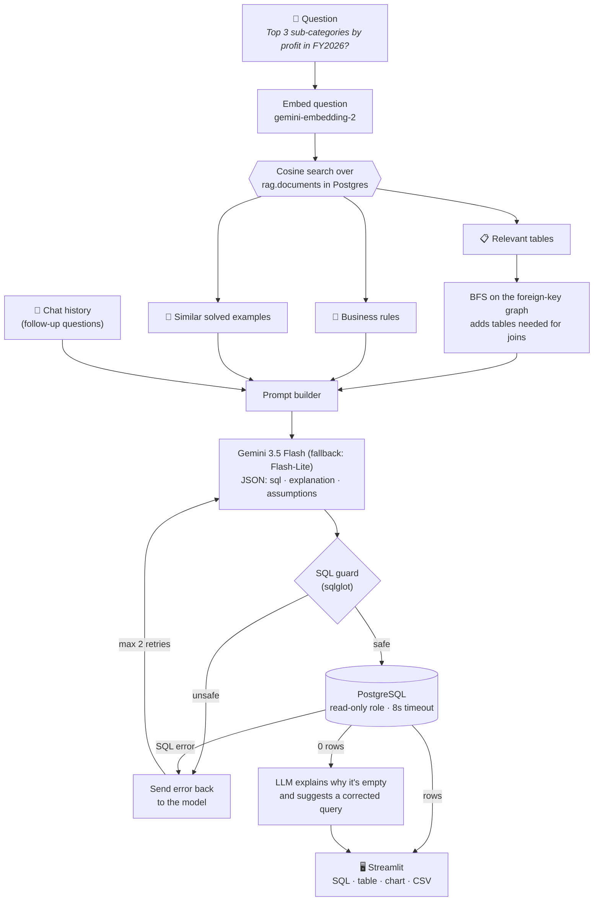
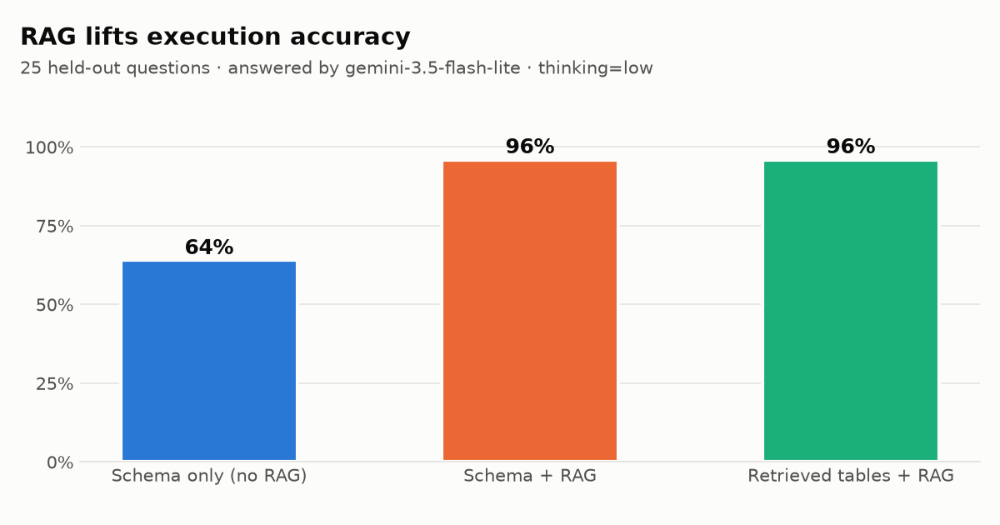
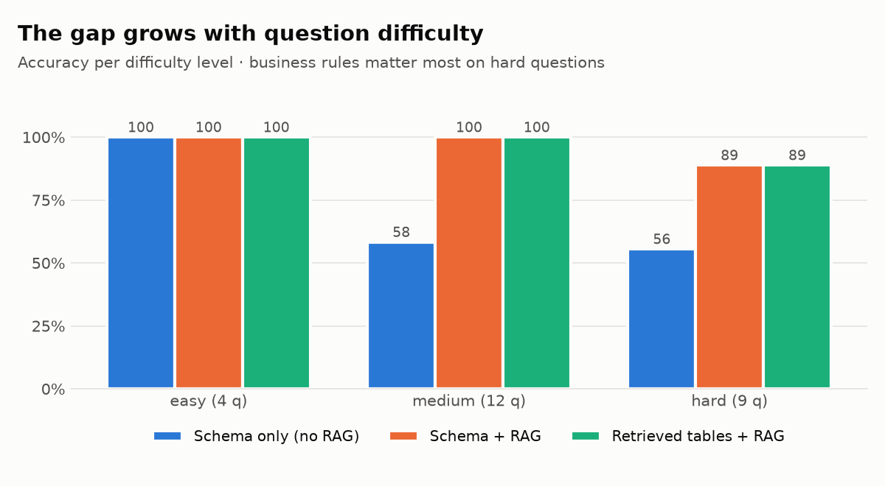
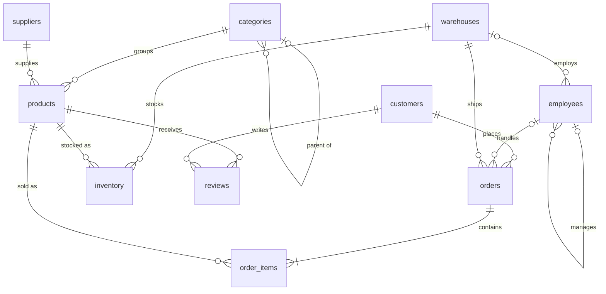

# TableTalk 🗄️💬

**Ask a PostgreSQL database questions in plain English.** TableTalk writes the SQL, checks it is safe, runs it, and shows the answer as a table and a chart, along with the exact query it used.


> **Example:** *"Which 3 sub-categories made the most profit in FY2026?"*
>
> → TableTalk knows the fiscal year runs **Apr 2025 – Mar 2026**, that profit = revenue − cost, and that cancelled and returned orders don't count. It joins 4 tables and returns `Laptops $303k · Cycling $230k · Furniture $116k`.

---

## 💡 The idea

Most business questions sit in a database, but answering them takes someone who knows SQL **and** the company's own definitions. A general-purpose LLM can write SQL, but it guesses at those definitions:

| The LLM guesses… | …but this company means |
|---|---|
| revenue = `SUM(unit_price)` | quantity × price × (1 − discount), **excluding cancelled & returned orders** |
| FY2026 = calendar 2026 | fiscal year **1 Apr 2025 – 31 Mar 2026** |
| `status = 'Canceled'` | the real value is `'cancelled'` |
| "top rated" = highest single review | average rating, **minimum 10 reviews** |

TableTalk adds three things around the LLM:

1. **RAG (retrieval-augmented generation).** Before writing SQL, the model is given the business rules and similar worked examples that match the question.
2. **Guardrails.** Generated SQL can only ever *read*, and this is enforced in three independent layers.
3. **Measurement.** A held-out test set shows whether each piece helps, using numbers rather than impressions.

## ⚙️ How it works



| Step | What happens | Code |
|---|---|---|
| **Retrieve** | The question is embedded and compared, by cosine similarity, with 49 stored documents: 10 table descriptions (columns, keys, comments and the *real* values of low-cardinality columns), 18 business rules, and 21 example queries that were each verified against the database | [`rag/retriever.py`](rag/retriever.py) |
| **Join path** | If the retrieved tables don't connect, a **breadth-first search** over the foreign-key graph finds the shortest join path (e.g. `reviews → customers → orders → employees`) | [`rag/retriever.py`](rag/retriever.py) |
| **Generate** | Gemini returns structured JSON. On free-tier `429`/`503` errors it retries with backoff, then falls back to a second model | [`core/llm.py`](core/llm.py) |
| **Guard** | sqlglot parses the query: exactly one `SELECT`, no DML/DDL/`SELECT INTO`, no `pg_*` functions, only the 10 store tables | [`core/sql_guard.py`](core/sql_guard.py) |
| **Execute** | Runs as `tabletalk_reader` in a read-only transaction with a timeout | [`core/executor.py`](core/executor.py) |
| **Self-correct** | On a SQL error, the model sees its own query plus the PostgreSQL error message and fixes it | [`core/pipeline.py`](core/pipeline.py) |
| **Empty results** | 0 rows? The LLM gets the data's real date ranges and values, decides whether "nothing" is the true answer or the query was too strict, and if needed proposes a corrected query (checked by the same guard) | [`core/pipeline.py`](core/pipeline.py) |

### Empty results are explained, not just shown as blank

| Question | What TableTalk says |
|---|---|
| *List the customers who live in Japan* | 🔍 **No matching data.** No customers live in Japan. Customers are in Australia, Canada, Germany, India, Singapore, UAE, UK and USA. |
| *Show the 10 biggest orders placed in December 2023* | ⚠️ **The query returned no rows.** Order data starts on 1 Jan 2024. 💡 *Same question for December 2024 instead:* it shows the suggested SQL and its 10 rows. |

### 🔒 Safety: three independent layers

| Layer | Blocks | Tested with |
|---|---|---|
| 1. sqlglot guard | anything that isn't a single SELECT on the store tables | `DELETE`, `UPDATE`, `SELECT 1; DROP TABLE`, `SELECT INTO`, `pg_sleep()`, `pg_catalog.*`, `rag.*` |
| 2. PostgreSQL role | writes, other schemas | `tabletalk_reader`: `SELECT` only, `default_transaction_read_only = on`, no access to the RAG schema |
| 3. Timeout | runaway queries | `statement_timeout = 8s` |

Each layer was tested on its own by sending the dangerous query straight past the layers before it.

## 📊 Evaluation

The test set has **25 held-out questions** (easy / medium / hard), and none of them appear in the RAG examples. Each has a hand-written gold query. A question counts as **correct when the generated SQL returns the same data as the gold query** (*execution accuracy*), because comparing SQL text is meaningless when many different queries are correct.

<picture>
  <source media="(prefers-color-scheme: dark)" srcset="docs/images/accuracy_by_mode_dark.png">
  
</picture>

<picture>
  <source media="(prefers-color-scheme: dark)" srcset="docs/images/accuracy_by_difficulty_dark.png">
  
</picture>

| Context the model sees | Accuracy | Easy | Medium | Hard | Avg time |
|---|---:|---:|---:|---:|---:|
| Schema only (baseline) | 64% | 4/4 | 7/12 | 5/9 | 12.1s |
| Schema + RAG rules & examples | **96%** | 4/4 | 12/12 | 8/9 | 10.3s |
| Retrieved tables (+BFS) + RAG | **96%** | 4/4 | 12/12 | 8/9 | 9.8s |

<sub>Run on 2026-11-25 with the Gemini free tier. The daily quota for `gemini-3.5-flash` was used up, so the automatic fallback **`gemini-3.5-flash-lite`** answered all 75 runs: even the smaller model reaches 96% with RAG.</sub>

**What the failures teach**

- **Without RAG, the misses are about business meaning, not SQL skill.** The baseline read *FY2026* as calendar 2026 (#7, #24), measured delivery time from shipping instead of from ordering (#8), excluded returned orders from "repeat customers" (#9), and ignored the 90-day window that defines an *active* customer (#17). All of these are fixed by a retrieved business rule.
- **Both RAG modes miss the same question (#20)**, and it's a SQL logic slip rather than a knowledge gap: `COUNT(DISTINCT customer_id) … GROUP BY customer_id` returns one row per customer instead of a single total.
- **Retrieving tables loses nothing.** Sending only the retrieved tables plus the BFS join path scored the same as sending the full schema. With 10 tables that isn't needed, but it's what would let this approach scale to a database with hundreds of tables.
- **Self-correction works.** In one baseline run the first query failed, and the model read the PostgreSQL error and fixed it.

**How the grading works** ([`eval/compare.py`](eval/compare.py)): rows are compared as sets. Column order and names don't matter, extra columns are allowed, numbers are compared with a ±0.05 tolerance (rounding *before* vs *after* a running total legitimately shifts cents), and "first + last name" can match a combined "full name". Free-tier `503` errors are retried rather than counted as wrong answers.

Reproduce with `python -m eval.run_eval`, or `--models gemini-3.5-flash gemini-3.5-flash-lite --modes rag` to compare models.

## 🗃️ The data

There are 10 tables for a fictional online store, generated by [`db/seed.py`](db/seed.py) with a fixed random seed, so every run produces identical data and comparable results.



| Table | Rows | Interesting for SQL practice |
|---|---:|---|
| customers | 2,000 | 8 countries; loyalty tier derived from lifetime spend |
| categories | 24 | two-level tree → **self-join** |
| suppliers | 25 | ratings |
| products | 300 | price + cost → profit & margin |
| warehouses | 6 | India, USA, UK, Germany |
| inventory | 1,260 | composite primary key; reorder levels |
| employees | 60 | org chart via `manager_id` → **`WITH RECURSIVE`** |
| orders | 14,211 | 6 statuses, 5 payment methods, shipping & delivery dates |
| order_items | 27,656 | discounts and historic prices |
| reviews | 6,759 | driven by a hidden per-product quality score |

<picture>
  <source media="(prefers-color-scheme: dark)" srcset="docs/images/monthly_orders_dark.png">
  
</picture>

## 🧠 Concepts used

- **DSA:** BFS shortest path on the foreign-key graph, a greedy Steiner-tree approximation to connect several tables, and cosine similarity / vector search with NumPy
- **DBMS:** normalized schema, foreign keys and self-references, indexes, roles and least privilege, read-only transactions, `COPY` bulk loading, catalog introspection (`pg_constraint`, `pg_attribute`)
- **SQL:** CTEs, window functions (`LAG`, `RANK`, `ROW_NUMBER`, running totals), `WITH RECURSIVE`, `FILTER`, anti-joins, date arithmetic
- **AI engineering:** embeddings, RAG, structured JSON output, self-correction loop, fallback models, offline evaluation

## 🚀 Run it locally

**Requirements:** Python 3.11+, PostgreSQL 15+, and a free Gemini API key from [Google AI Studio](https://aistudio.google.com).

```bash
git clone https://github.com/Sweksha-Kakkar/Text-To-SQL.git
cd Text-To-SQL
python -m venv .venv
.venv\Scripts\activate            # macOS/Linux: source .venv/bin/activate
pip install -r requirements.txt
```

Create a `.env` file in the project folder:

```ini
GEMINI_API_KEY=your-key-here
PG_HOST=localhost
PG_PORT=5432
PG_SUPERUSER=postgres
PG_SUPERUSER_PASSWORD=your-postgres-password
# tabletalk_app / tabletalk_reader passwords are generated and added automatically
```

Build the database and the RAG index, then launch:

```bash
python -m db.setup_db        # creates database, roles, 10 tables, loads data (~5s)
python -m rag.build_index    # verifies examples, embeds 49 docs
streamlit run app.py         # http://localhost:8501
```

<details>
<summary>Windows without admin rights: portable PostgreSQL</summary>

Download the *binaries* zip from EnterpriseDB, extract it to `%LOCALAPPDATA%\Programs\PostgreSQL17`, run `initdb`, then start and stop the server with [`scripts/start_db.ps1`](scripts/start_db.ps1) and [`scripts/stop_db.ps1`](scripts/stop_db.ps1).
</details>

## 📁 Project layout

```
├── app.py                 Streamlit UI: Ask · Database · Evaluation pages
├── config.py              models, limits, connection settings
├── core/
│   ├── pipeline.py        retrieve → generate → guard → execute → self-correct → explain empty
│   ├── llm.py             Gemini client: structured output, retries, fallback model
│   ├── sql_guard.py       sqlglot safety checks
│   ├── executor.py        read-only execution
│   └── schema.py          reads tables / keys / comments / values from pg_catalog
├── rag/
│   ├── build_index.py     verifies examples, embeds docs, stores vectors in Postgres
│   ├── retriever.py       cosine search + BFS join-path expansion
│   └── knowledge/         glossary.json (business rules), examples.json (worked queries)
├── db/                    schema.sql, seed.py (data generator), setup_db.py
├── eval/                  test_set.json, run_eval.py, compare.py, results/
├── docs/                  make_charts.py, images/
└── scripts/               start_db.ps1, stop_db.ps1
```

## 🛣️ Roadmap

- [ ] Fine-tune a small open model (Gemma from Hugging Face, LoRA) on the examples and compare it with Gemini on the same test set
- [ ] Move vector search into PostgreSQL with **pgvector**, or implement an HNSW index from scratch
- [ ] Ask clarifying questions when a question is ambiguous ("revenue": gross or net?)
- [ ] Deploy on Streamlit Community Cloud with a managed Postgres (Neon / Supabase)
